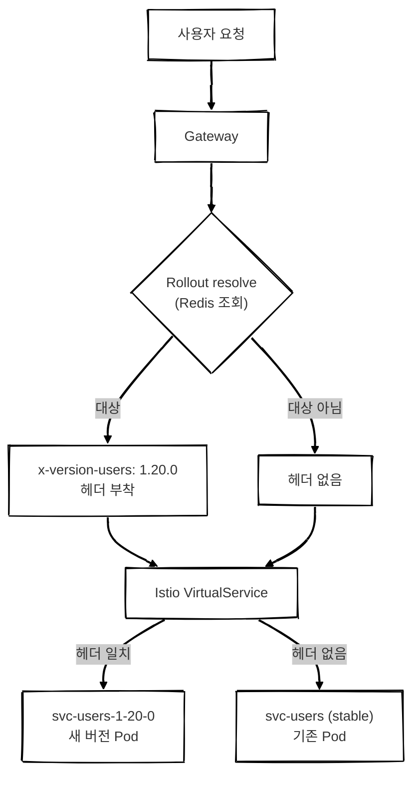
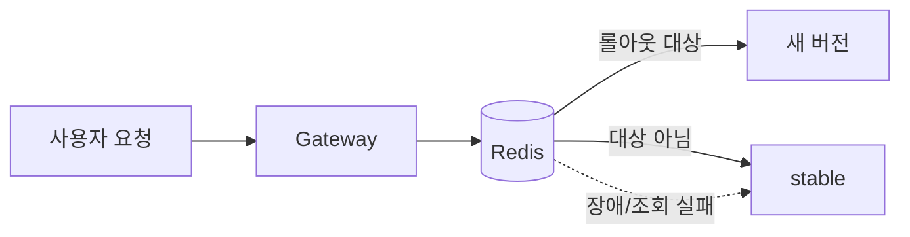
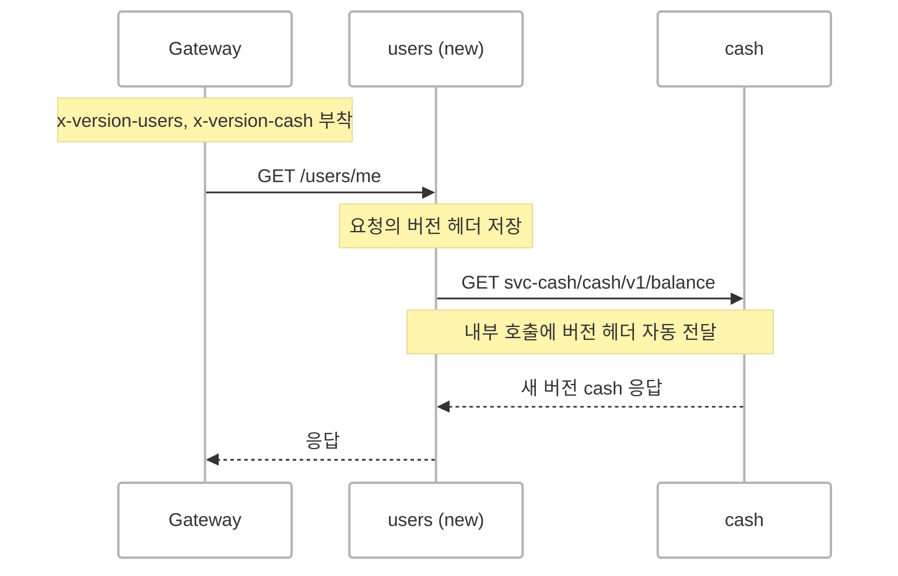

## 개요
  
배포를 해본 개발자라면, 배포가 끝날 때까지 마음을 놓기 어려웠던 경험이 한 번쯤은 있을 겁니다.

테스트를 아무리 충분히 수행해도 실제 운영 환경에서만 드러나는 버그는 존재합니다. 특정 계정의 데이터 형태에서만 발생하는 문제, 동시 요청이 몰릴 때만 재현되는 문제, 외부 시스템과의 연동 때문에 스테이지 환경에서는 확인할 수 없는 문제들이 대표적입니다. 이런 종류의 이슈는 배포 전에 완벽하게 검증하기가 어렵습니다.

 

### 점진적 배포를 적용하지 않은 일반적인 배포 방식

점진적 배포를 적용하지 않은 일반적인 배포에서는 새로운 버전이 배포되는 순간 모든 사용자가 동시에 새로운 버전을 사용하게 됩니다. 배포된 버전에 문제가 있다면, 그 문제 역시 모든 사용자에게 한꺼번에 노출될 수 있습니다.

그래서 배포 직후에는 모니터링에 집중하게 됩니다. 문제가 발견되면 빠르게 이전 버전으로 롤백해야 합니다. 하지만 롤백을 결정하고 실제로 이전 버전이 배포되기까지도 시간이 필요하고 그동안 사용자는 계속 서비스를 이용하고 있습니다.

특히 결제나 메시지 발송처럼 비용이나 비즈니스에 직접적인 영향을 주는 기능에서는 문제가 발생했을 때의 영향이 더욱 큽니다. 대규모 고객에게 문제가 발생한다면 피해 규모도 그만큼 커질 수 있습니다.

하지만 이러한 배포 방식에서는 누구에게 새로운 버전을 먼저 보여줄지 선택할 수 없습니다.
  
 

### 어떻게 진행되는가

롤아웃은 한 번에 모든 사용자에게 새로운 버전을 배포하지 않습니다. 대상 범위를 단계적으로 확대하면서 각 단계마다 서비스 상태를 확인합니다.

1. 롤아웃을 시작하면 **관리자 계정만** 새로운 버전을 사용합니다. 실제 운영 환경에서 주요 기능과 동작을 먼저 확인합니다.
2. 이상이 없다면 다음 단계로 넘어갑니다. 초기 단계에서는 미사용자와 소액 사용자를 대상으로 새로운 버전을 노출합니다.
3. 각 단계에서 서비스 상태를 확인한 뒤 문제가 없으면 다음 단계로 범위를 확대합니다. 단계가 올라갈수록 더 많은 사용자가 새로운 버전을 사용하고 가장 영향도가 큰 고객은 마지막 단계에 포함됩니다.
4. 이상 징후가 발견되면 **이전 단계로 롤아웃 범위를 축소합니다.** 배포 전체를 이전 버전으로 되돌리는 것이 아니라, 새로운 버전을 사용하는 대상만 줄이는 것입니다.
5. 범위를 축소한 상태에서 원인을 분석합니다. 실제 문제로 확인되면 수정한 버전으로 교체한 뒤 다시 롤아웃을 진행하고 문제가 아닌 것으로 판단되면 중단했던 단계부터 다시 범위를 확대합니다.

이 구조에서 가장 중요한 부분은 **4번, 문제가 발생했을 때 롤아웃 범위만 축소할 수 있다는 점**입니다.

기존에는 문제가 발견되면 선택지가 사실상 두 가지였습니다. 문제를 감수하고 배포를 유지하거나, 전체를 이전 버전으로 롤백하는 것입니다. 특히 롤백 역시 하나의 배포 과정이기 때문에, 실제로 롤백을 수행하기까지 판단과 실행에 시간이 필요했습니다.

반면 롤아웃에서는 먼저 **노출 범위를 줄여 영향을 최소화한 뒤 원인을 확인할 수 있습니다.**

즉, 문제가 발생했을 때 바로 롤백을 결정할 필요가 없습니다. 먼저 영향 범위를 줄이고 그 상태에서 원인을 분석한 뒤 다음 행동을 결정할 수 있습니다. 이처럼 **배포와 롤백 사이에 하나의 완충 단계를 둔 것**이 이 롤아웃 구조의 핵심입니다.

 

## 무엇을 만들었나

이번에 구현한 것은 크게 세 가지입니다.

1. **Istio 기반 버전 라우팅** — 특정 헤더가 포함된 요청을 새로운 버전의 Pod로 라우팅합니다.
2. **Rollout 서비스** — 어떤 사용자를 언제 새로운 버전에 포함할지 결정하고 단계적으로 적용 범위를 확대합니다.
3. **헤더 전파** — 마이크로서비스 간 호출에서도 동일한 버전 정보가 유지되도록 헤더를 전달합니다.

전체적인 흐름은 다음과 같습니다.

여기서 핵심은 Gateway는 새로운 버전을 사용할 대상인지 판단하고 헤더만 추가하며, 실제 버전 라우팅은 Istio가 담당한다는 점​입니다.

Gateway는 특정 사용자가 새로운 버전의 대상인지 확인한 뒤 대상이라면 x-version-users 헤더를 추가합니다. 이후 요청은 Istio의 VirtualService가 해당 헤더를 기준으로 새로운 버전의 Pod 또는 기존 버전의 Pod로 라우팅합니다.

덕분에 애플리케이션은 자신이 어떤 버전으로 실행되고 있는지, 특정 사용자가 롤아웃 대상인지 알 필요가 없습니다. 롤아웃 대상 판단과 버전 라우팅을 애플리케이션 코드와 분리할 수 있습니다.

 

### 1. 누구를 먼저 태울 것인가

앞서 설명한 것처럼, 우리는 무작위로 사용자를 선택하는 대신 계정의 중요도에 따라 새로운 버전의 노출 순서를 결정합니다.

롤아웃을 시작할 때 계정별 중요도 점수를 한 번에 조회하고, 이를 스냅샷으로 고정합니다. 롤아웃 도중 점수가 변경되더라도 시작 시점의 점수를 기준으로 대상을 판단합니다. 그래야 롤아웃이 진행되는 동안 같은 사용자가 새 버전과 기존 버전 사이를 오가는 일을 막을 수 있습니다.

점수가 낮을수록 먼저 새로운 버전을 사용합니다. 관리자 계정에서 시작해 미사용·소액 사용자, 일반 사용자, 우량 사용자 순으로 단계적으로 대상을 확대하고 가장 영향도가 높은 고객은 마지막에 포함합니다.

각 단계의 범위는 고정된 값이 아닙니다. 배포의 위험도나 변경 규모에 따라 초기 단계를 더 세분화하거나, 필요한 경우 특정 단계를 생략하는 등 롤아웃마다 다르게 구성할 수 있습니다.

여기서 중요한 것은 퍼센티지가 트래픽 비율을 의미하지 않는다는 점입니다.

예를 들어 30% 단계라고 해서 무작위로 30%의 사용자를 선택하는 것이 아닙니다. 중요도 점수가 해당 기준 이하인 모든 계정이 대상이 됩니다. 따라서 같은 사용자는 해당 단계가 유지되는 동안 계속 동일한 버전을 사용합니다.

이렇게 하면 영향도가 낮은 사용자부터 새로운 버전을 경험하게 하면서, 문제가 발생했을 때 중요한 고객에게 미치는 영향을 최소화할 수 있습니다.

또한 첫 번째 단계는 관리자 계정만을 대상으로 하기 때문에, 배포 직후 실제 운영 환경에서 먼저 새로운 버전을 확인할 수 있습니다.

 

### 2. Gateway의 판단 — Redis만으로

Gateway에서는 Rollout 서비스에 매 요청 HTTP 요청을 보내지 않고 Redis에서 롤아웃 상태를 조회합니다. Rollout 서비스는 상태가 변경될 때 Redis를 갱신하고 Gateway는 이를 읽어 헤더를 결정합니다.

중요한 것은 롤아웃 기능에 문제가 생겨도 서비스 자체에는 영향을 주지 않는 것입니다. Redis 조회에 실패하거나 롤아웃 정보를 정상적으로 읽지 못하면 헤더를 붙이지 않고 stable로 보냅니다.

 

### 3. 마이크로서비스끼리도 버전이 따라가야 한다

여기서 한 가지 문제가 생겼습니다.

Gateway가 `users` 서비스로 요청을 보낼 때 `x-version-users` 헤더를 붙인다고 해보겠습니다. 그런데 `users`가 내부적으로 `cash` 서비스를 호출하면, 이 요청에는 버전 정보가 전달되지 않습니다.

그러면 `users`는 새 버전인데 `cash`는 stable인 상태가 될 수 있습니다.

같이 배포되어야 하는 서비스가 여러 개라면 이런 버전 불일치는 예상하지 못한 동작으로 이어질 수 있습니다.

가장 단순한 방법은 각 서비스에서 내부 API를 호출할 때마다 버전 헤더를 직접 전달하는 것입니다. 하지만 서비스가 많고 HTTP 클라이언트도 제각각이라, 모든 호출 지점에서 이를 처리하면 누락될 가능성이 높습니다.

그래서 버전 전파를 애플리케이션 코드와 분리했습니다.

들어온 요청의 `x-version-*` 헤더를 요청 컨텍스트에 저장해두고, Node.js의 `http.request` 레벨에서 내부 서비스 호출을 가로채 해당 헤더를 자동으로 주입하도록 했습니다.

즉, 서비스 코드에서는 별도로 버전 헤더를 전달할 필요가 없습니다.

외부 API 호출에는 버전 헤더를 전달하지 않고 이미 명시적으로 지정된 헤더가 있다면 이를 우선하도록 처리했습니다.

이렇게 해서 `users → cash → ...`처럼 서비스 호출이 이어지더라도 처음 Gateway에서 결정된 버전 정보가 내부 호출을 따라 계속 전달됩니다. 각 서비스는 자신이 롤아웃 대상인지 별도로 판단하지 않아도 됩니다.

 

## 결과

가장 크게 달라진 것은 **배포에 대한 부담이 줄었다는 점**입니다.

예전에는 배포 버튼을 누른 뒤 한동안 대시보드에서 모니터링을 이어가야 했습니다. 지금은 스테이지 0에서 관리자 계정으로 먼저 실제 운영 환경을 확인하고 문제가 없으면 10% 단계로 확대합니다. 초기 단계에서 문제가 발견되더라도 영향 범위는 제한적이고 소액 사용자 구간에서 먼저 확인할 수 있습니다.

무엇보다 **판단을 서두를 필요가 없어졌습니다.** 이상 징후가 보이면 우선 `retreat`로 노출 범위를 줄여놓고 원인을 확인합니다. 전체를 롤백하는 것이 아니라 잠시 이전 단계로 물러나는 것이기 때문에, "지금 롤백해야 하는가?"를 즉시 결정하지 않아도 됩니다. 원인을 확인한 뒤 문제가 아니라면 다시 `advance`하면 됩니다.

팀의 배포 방식도 달라졌습니다. 이전에는 배포를 앞두고 위험도가 높다고 판단되면 일정을 미루는 경우가 있었지만, 이제는 배포를 더 작은 단계로 나누어 진행할 수 있게 됐습니다. 배포의 위험을 한 번에 감수하는 대신, **작은 범위에서 확인하고 문제가 없으면 다음 단계로 넘어가는 방식**이 자리 잡았습니다.

결과적으로 배포는 한 번에 끝내야 하는 작업이 아니라, **작게 노출하고 확인하면서 점진적으로 확대하는 과정**이 되었습니다.

기술적으로는 다음과 같은 선택들이 이 구조를 안정적으로 만드는 데 중요했습니다.

* **결제 금액 기준으로 노출 순서 결정** — 무작위 N%가 아니라 고객 중요도에 따라 노출 범위를 조절
* **롤백 대신 범위 축소** — 문제가 발생해도 우선 영향 범위를 줄인 뒤 원인을 확인
* **VirtualService를 통한 버전 라우팅** — 롤아웃을 사용하지 않으면 기존 stable 라우팅과 동일하게 동작
* **Gateway는 Redis 조회만 수행** — Rollout 서비스에 장애가 발생해도 서비스 요청 자체에는 영향을 주지 않음
* **실패 시 stable로 fallback** — 롤아웃 기능의 장애가 서비스 장애로 이어지지 않도록 구성
* **`http.request` 레벨에서 헤더 전파** — 개별 서비스 코드를 수정하지 않고 마이크로서비스 간 버전 정보를 전달

