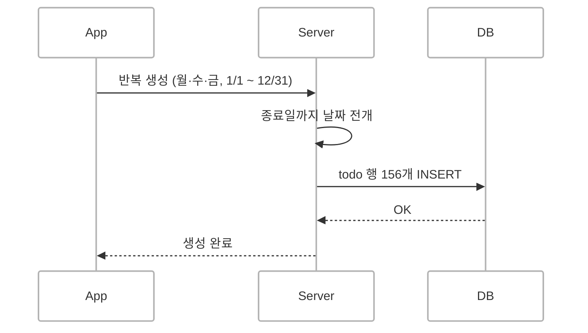
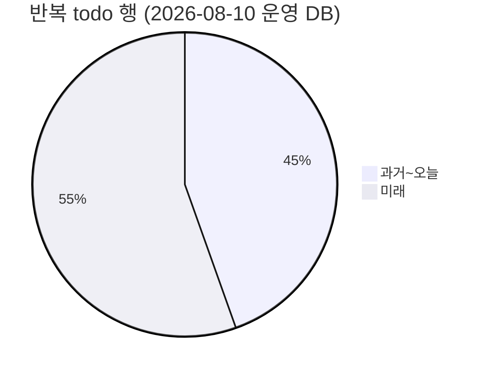
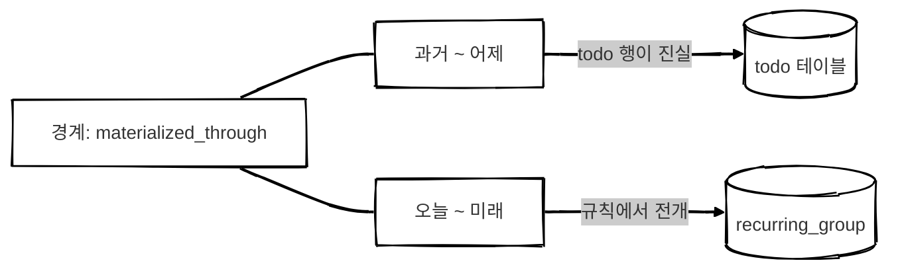
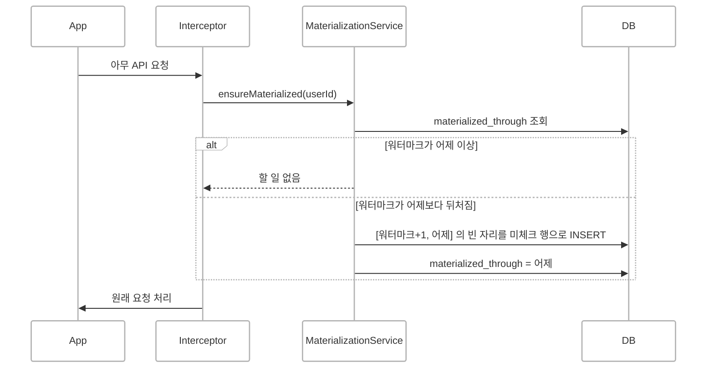
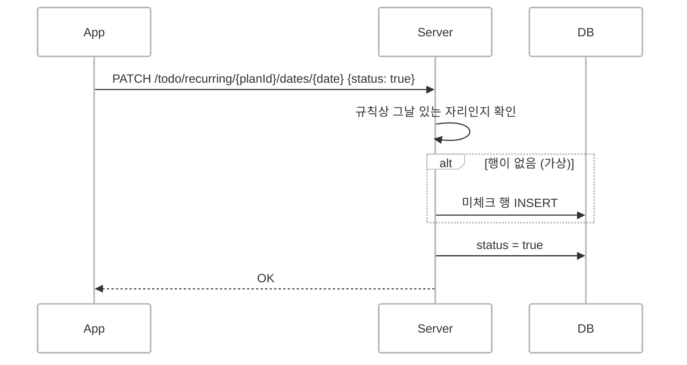
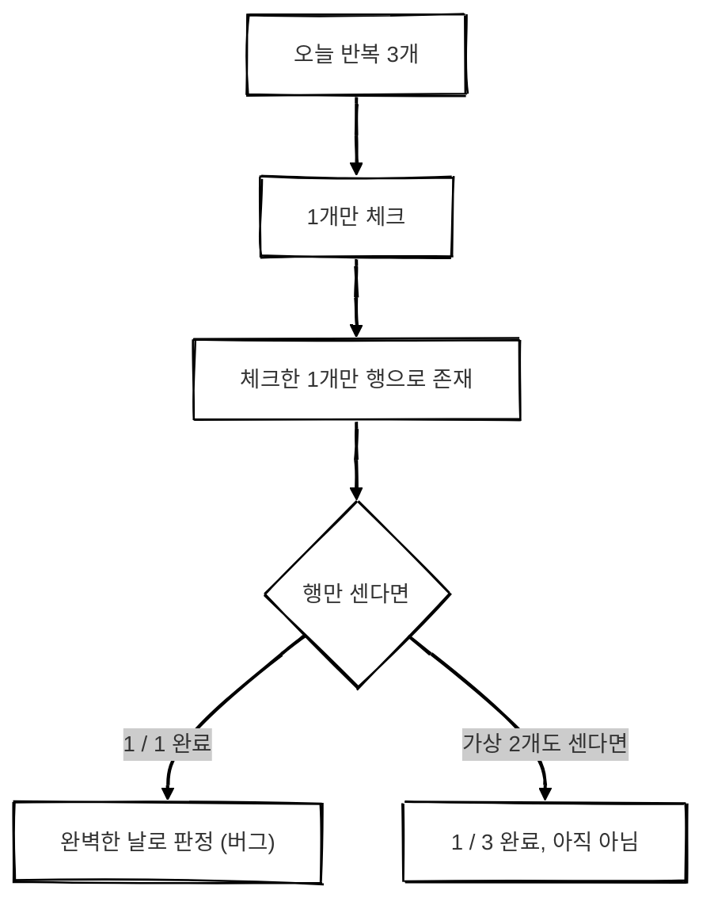
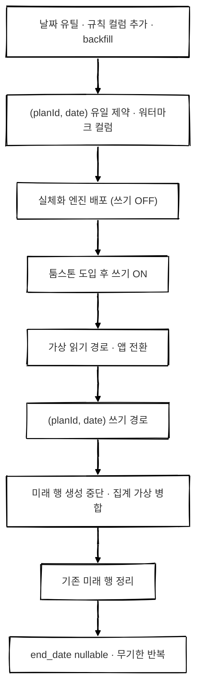
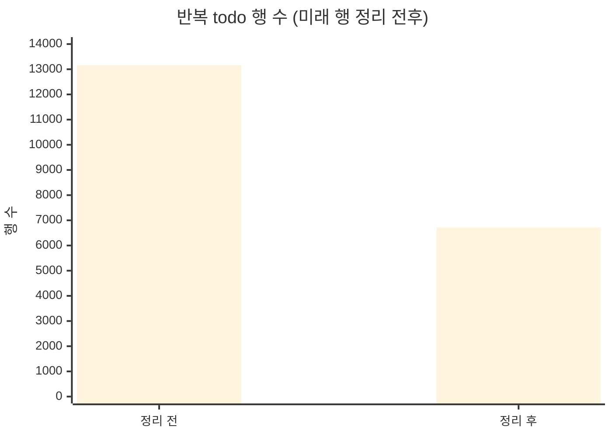

## 개요

OrbitMe 실천목록에는 **반복 투두**가 있습니다.
"매주 월·수·금 운동하기"처럼 요일과 기간을 정해 두면 그날마다 할 일이 나타나는 기능입니다.

처음에는 가장 단순하게 만들었습니다.
반복을 만드는 순간 **시작일부터 종료일까지 해당 요일마다 todo 행을 전부 INSERT** 하는 방식입니다.



조회도, 체크도, 통계도 전부 "행"만 보면 됐기 때문에 처음엔 편했습니다.
그런데 운영을 하다 보니 이 방식이 답이 아니라는 신호가 하나씩 보이기 시작했습니다.

<br/>

## 한계

### 1. 종료일이 반드시 있어야 했다

행을 미리 만들려면 **어디까지 만들지**가 정해져 있어야 합니다.
그래서 반복에는 종료일이 필수였고, "무기한 반복"은 구조적으로 만들 수 없었습니다.

그런데 사용자들은 무기한을 원했습니다.
종료일을 비울 수 없으니 **종료일을 아주 멀리 잡아서 무기한을 흉내** 냈습니다.

2026-08-22 운영 DB에서 직접 확인한 수치입니다.

| 항목 | 값 |
| --- | --- |
| 활성 반복 그룹 | 63개 |
| 그중 종료일이 `2026-12-31` 인 그룹 | **56개 (89%)** |
| 가장 먼 미래 행 | 374일 뒤 |

대부분이 "올해 끝까지"를 사실상 "계속"의 의미로 쓰고 있었습니다.
그 말은 곧 **2027년 1월 1일에 반복 56개가 한꺼번에 끝난다**는 뜻이기도 했습니다.
저희는 이걸 "12/31 절벽"이라고 불렀습니다.

<br/>

### 2. DB의 절반 이상이 아직 오지 않은 날이었다

종료일을 멀리 잡으니 행도 그만큼 쌓였습니다.

2026-08-10 운영 DB 기준, 반복 todo 행 13,291개 중 **7,368개(55%)가 미래 날짜**였습니다.



그리고 그 미래 행 중 **체크된 행은 0개**였습니다.
아직 오지 않은 날이니 당연합니다.
즉 절반이 넘는 행이 "규칙만 있으면 언제든 다시 계산할 수 있는 값"을 저장하고 있었습니다.

<br/>

### 3. 규칙을 바꾸면 미래를 지우고 다시 만들어야 했다

요일을 바꾸면 미래 행을 지우고 새 요일로 다시 INSERT 했습니다.
이 과정에서 todo id가 전부 새로 발급되고, 궤도별 통계 카운터 보정도 빠져 있었습니다.
행이 많을수록 이런 "동기화"가 늘어났습니다.

<br/>

> 무기한 반복을 하려면 미래를 미리 만들면 안 된다.
> 미래는 저장하지 말고, 규칙에서 그때그때 계산하자.
{: .prompt-tip }

<br/>

## 어디까지 가상으로 둘까

처음에는 과거까지 전부 규칙에서 계산하는 **전면 가상화**도 검토했습니다.
행이 거의 없어지니 가장 깔끔해 보였습니다.

하지만 몇 번을 다시 검토해도 결론은 같았습니다.

- **과거가 소급해서 바뀝니다.** 오늘 요일을 바꾸면 지난달 기록까지 새 요일로 다시 계산됩니다.
- **통계가 무너집니다.** 리포트의 연속 기록(streak)은 "할 일이 없는 날은 중립"으로 셉니다. 손대지 않은 과거 날을 저장하지 않으면 아무것도 안 한 날이 "할 일 없는 날"이 되어 **streak가 영원히 끊기지 않습니다.**
- **이득이 없습니다.** 행이 폭발한 건 미래 쪽이었습니다. 과거 행은 1년에 수천 개 수준이라 Postgres 입장에선 문제가 안 됩니다.

그래서 이렇게 정했습니다.



- **과거는 실체화** — 지나간 날은 todo 행으로 굳히고, 그 뒤로는 규칙이 바뀌어도 건드리지 않습니다.
- **미래는 가상** — 행 없이 `recurring_group` 의 규칙(시작일·종료일·요일)에서 전개해 응답합니다.
- **경계는 유저별 워터마크** — `user.materialized_through` 에 "어디까지 굳혔는지"를 저장합니다.

<br/>

## 실체화가 필요한 지점

미래를 가상으로 두더라도, 결국 어느 순간에는 행이 필요합니다.
행이 생기는 지점은 딱 세 곳으로 정리했습니다.

### 1. 하루가 지났을 때 — 워터마크 전진

어제까지는 행이 진실이어야 합니다.
그래서 하루가 지나면 그 하루치를 행으로 굳히고 워터마크를 한 칸 옮깁니다.

배치 대신 **인증된 요청이 들어올 때 인터셉터에서 lazy 하게** 처리했습니다.
평소에는 워터마크를 확인하는 조회 한 번으로 끝나고, 하루에 한 번만 실제로 행을 만듭니다.



오늘은 굳히지 않습니다.
오늘은 아직 진행 중이라, 가상으로 두어야 반복 규칙을 고쳤을 때 오늘 항목에 바로 반영됩니다.

오래 안 들어온 유저는 그 사이 며칠이 한 번에 굳어집니다.
구간을 자르지 않은 이유는, 잘라 버리면 워터마크가 그 날들을 지나쳐 **영영 채워지지 않기** 때문입니다.
느린 요청 한 번보다 조용한 데이터 손실이 더 나쁘다고 판단했습니다.

<br/>

### 2. 사용자가 쓸 때 — 체크와 삭제

미래나 오늘의 가상 항목에는 todo id가 없습니다.
그래서 클라이언트는 id 대신 **`(planId, date)`** 로 항목을 가리키도록 바꿨습니다.



삭제도 같은 주소를 씁니다.
여기서 중요한 건 **"당일만 삭제"한 자리를 지우면 안 된다**는 점입니다.
행을 지워 버리면 "규칙상 있어야 하는데 행이 없는 날"이 되고, 다음 날 엔진이 그 자리를 다시 채워 **지운 항목이 되살아납니다.**

그래서 삭제는 `deleted_at` 을 채운 **툼스톤**으로 남기고, 툼스톤도 "이미 자리를 차지한 것"으로 봅니다.

<br/>

### 3. 과거에 시작하는 반복을 만들 때

시작일을 과거로 잡은 반복을 만들면, 시작일부터 어제까지는 이미 워터마크 안쪽입니다.
엔진은 `[워터마크+1, 어제]` 만 보고, 읽기 경로는 워터마크 안쪽을 전개하지 않으니 **그 날들은 아무도 채워 주지 않습니다.**

그래서 생성 시점에 **워터마크 이하 구간만 행으로 만들고**, 그 뒤는 가상으로 둡니다.

<br/>

### 자리 판정 규칙

세 지점 모두 같은 규칙으로 "이 자리가 이미 있는가"를 판단합니다.

- **판정 단위는 `(planId, date)`** — "그날 아무 행이나 있으면 건너뛴다"로 하면, 단발 투두 하나 때문에 그날 반복이 통째로 사라집니다. 실제로 첫 설계가 이랬고, 설계를 다시 보다가 잡았습니다.
- **툼스톤도 점유로 본다** — 그래서 이 판정 쿼리만은 일부러 `deleted_at IS NULL` 을 걸지 않습니다.
- **`(recurring_group_id, date)` 유일 제약** — 엔진이 두 번 돌아도, 두 요청이 동시에 돌아도 행이 중복되지 않습니다. INSERT 는 `skipDuplicates` 로 멱등하게 처리합니다.

<br/>

## 카운트할 때 고려해야 하는 것

가상화에서 가장 신경 쓴 부분은 화면이 아니라 **집계**였습니다.

화면은 처음부터 가상 항목을 합쳐서 보여 주도록 만들었습니다.
문제는 "행만 세던" 곳들이었습니다.
미래 행이 사라지면 이 집계들은 **조용히 틀린 값을 냅니다.** 에러는 나지 않습니다.

| 집계 | 행만 세면 생기는 문제 |
| --- | --- |
| 이번 주 달성률 · 주간 그래프 | 이번 주 남은 예정이 빠져 달성률이 뛰고, 미래 막대가 0 이 됨 |
| 연속 기록(streak) | 오늘 남은 할 일이 빠져 부풀려짐 |
| 완벽한 날 · 별돌 | 남은 할 일이 안 보여 하나만 체크해도 완벽한 날이 됨 |
| 궤도별 `completedDays` 카운터 | 같은 이유로 잘못 증가 |
| 궤도 월별 통계 | 이번 달 남은 날의 일별 통계와 반복 일정이 사라짐 |
| 리마인더 알림 | "남은 할 일 N개"에서 가상 항목이 빠짐 |

가장 위험했던 건 별돌이었습니다.
OrbitMe에서 별돌은 **하루 할 일을 전부 끝낸 날**에 받는 보상입니다.



체크하는 순간 그 하나만 행이 되기 때문에, 행만 세면 `1/1` 이 되어 버립니다.

그래서 **규칙에서 전개하는 로직을 서비스 하나(`VirtualOccurrenceService`)로 모으고**, 모든 집계가 같은 함수를 거치게 했습니다.

- `expandRange(userId, from, to)` — 구간 안에서 아직 행이 없는 자리를 돌려줍니다. 워터마크 이하는 알아서 잘라 내서, 넓게 불러도 실제 전개 구간은 오늘 앞뒤뿐입니다.
- `countPendingByCategory(categoryId, date)` — 그날 그 궤도에 아직 체크되지 않은 가상 항목 수. 0보다 크면 그날은 완벽할 수 없습니다.

가상 항목은 아직 아무도 체크하지 않았으니 **항상 미완료**로 셉니다.

리포트 응답은 가상화 전후로 같은 데이터를 넣고 **응답 전체를 diff** 해서 전 필드가 일치하는 것을 확인했습니다.

<br/>

## 무기한 반복

미래를 저장하지 않게 되면서 드디어 종료일을 비울 수 있게 됐습니다.
`recurring_group.end_date` 를 nullable 로 바꾸고, `null` 을 무기한으로 정했습니다.

여기에도 함정이 하나 있었습니다.

```ts
// 무기한(end_date IS NULL) 반복이 조용히 빠진다
where: { endDate: { gte: from } }

// NULL 을 명시적으로 포함해야 한다
where: { OR: [{ endDate: null }, { endDate: { gte: from } }] }
```

Postgres에서 `NULL >= X` 는 참도 거짓도 아닌 `NULL` 이라 조건에 걸리지 않습니다.
컬럼만 nullable 로 바꾸고 조회 조건을 그대로 두면 **무기한 반복이 모든 화면에서 사라지는데, 에러는 나지 않습니다.**
이 조건이 걸린 곳을 전수로 찾아 고쳤습니다.

전개 함수는 무기한이어도 요청한 구간(`to`)까지만 펼치기 때문에 끝없이 늘어나지 않습니다.

<br/>

## 배포는 잘게 나눠서

한 번에 바꾸기엔 건드리는 곳이 너무 많았습니다.
그래서 **각 단계가 단독으로 배포되어도 사용자에게 아무 변화가 없도록** 17단계로 나눴습니다.



그중 두 가지가 특히 효과가 있었습니다.

**실체화 엔진을 "쓰기 꺼짐"으로 먼저 배포했습니다.**
엔진은 행을 만들지 않고 "만들 뻔한 개수"만 로그로 남기면서 워터마크는 매일 밀었습니다.
이때는 모든 미래가 행으로 존재하던 시기라, "규칙상 있어야 하는데 행이 없는 날"은 전부 **사용자가 지운 날**이었습니다.
그 날들이 워터마크 뒤로 먼저 넘어가 버린 덕분에, 나중에 쓰기를 켰을 때 되살아날 대상이 거의 남지 않았습니다.

**기존 미래 행을 지울 때 조건을 하나 더 걸었습니다.**
처음 조건은 "반복 todo 이고, 워터마크와 오늘보다 뒤이고, 삭제되지 않은 행"이었습니다.
그런데 실행 직전에 확인해 보니 **미리 체크된 행이 운영에 1건** 있었습니다.
`status = false` 조건을 추가하지 않았다면 그 기록이 날아갔을 겁니다.

<br/>

## 결과

정리 단계에서 반복 todo 행이 **13,161개 → 6,718개**로 줄었습니다. 6,443개를 지웠습니다.



절반 가까운 행을 지웠는데 **앱 화면은 그대로**였습니다.
지운 자리를 가상 항목이 정확히 메웠다는 뜻이고, 이 작업에서 가장 확인하고 싶었던 장면이었습니다.

그리고 이제 반복을 만들어도 미래 행은 늘어나지 않습니다.
행은 하루가 지나거나 사용자가 체크할 때만 생깁니다.
종료일 없이 저장하는 무기한 반복도 열었습니다.

<br/>

## 돌아보며

- **"행 → 규칙"으로 옮길 땐 읽기만이 아니라 쓰기 경로도 전수로 봐야 합니다.** 체크·삭제만 `(planId, date)` 로 옮기고 제목 수정은 행을 전제로 남겨 둔 탓에, 미래에 행이 없는 반복의 제목을 바꾸면 404가 나는 버그를 배포 후에 찾았습니다.
- **조용히 틀리는 곳이 제일 무섭습니다.** 집계 누락, `NULL` 비교, 지운 항목 부활 모두 에러 없이 틀린 값만 냈습니다.
- **같은 원칙을 다른 기능에도 그대로 쓸 수 있습니다.** 이후에 만든 "함께 챌린지"의 할 일도 처음에는 기간만큼 행을 미리 만들었는데, 같은 엔진과 같은 집계 경로에 붙여 미래는 가상으로 바꿨습니다.
