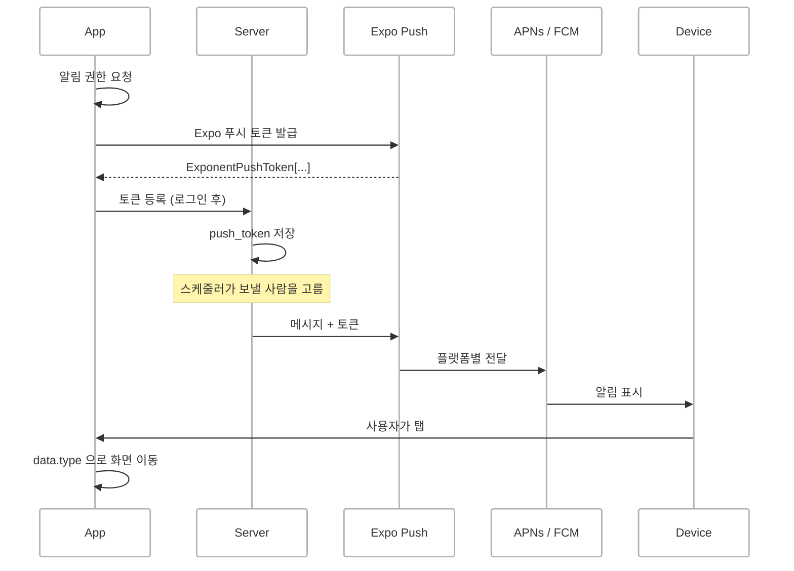
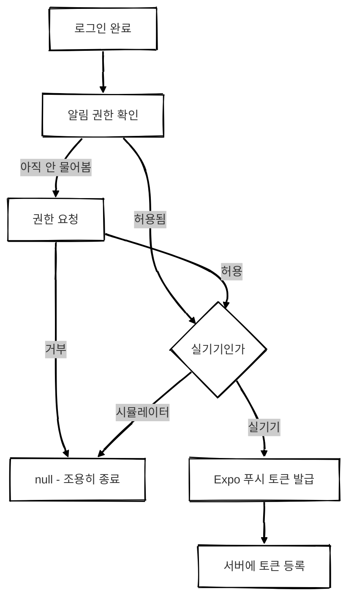
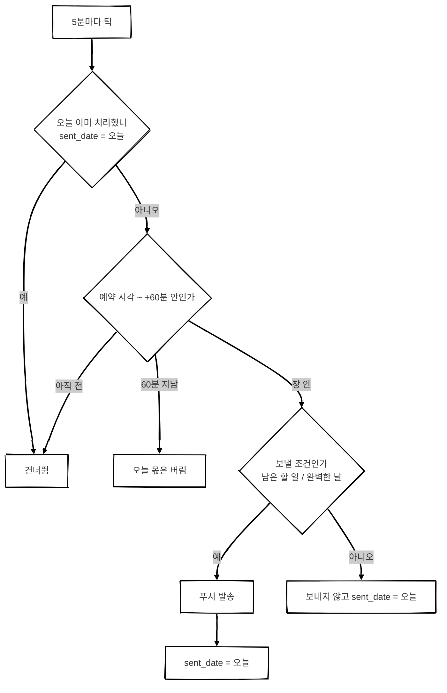
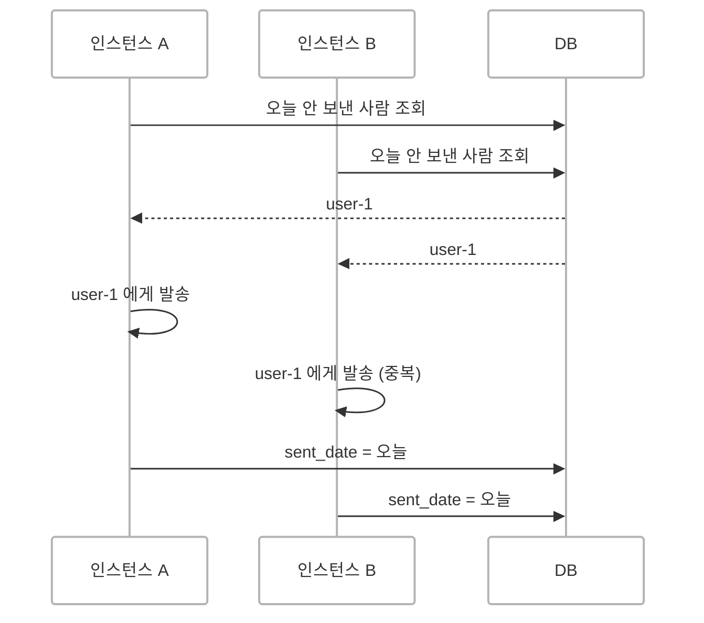
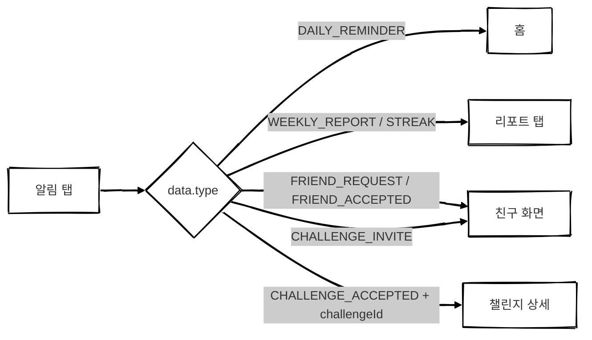

## 개요

OrbitMe는 목표를 세우고 매일 실천목록을 체크하는 앱입니다.
이런 앱은 사용자가 **앱을 열어야** 의미가 있는데, 열게 만들 수단이 없었습니다.

그래서 푸시 알림을 붙였습니다.
처음 정한 알림은 세 가지입니다.

| 알림 | 언제 | 조건 |
| --- | --- | --- |
| 매일 리마인더 | 사용자가 고른 시각 (기본 08:00) | 오늘 남은 할 일이 있을 때만 |
| 주간 리포트 | 일요일 20:00 | 지난주 달성률 요약 |
| 스트릭 축하 | 매일 22:00 | 그날 할 일을 전부 끝냈을 때만 |

이후 친구 기능과 함께 챌린지가 생기면서 친구 요청·수락·응원, 챌린지 제안·수락 같은 알림이 더 붙었습니다.

 

## 전체 흐름

앱은 Expo(React Native)이고, 서버는 NestJS입니다.
APNs와 FCM을 직접 붙이지 않고 **Expo Push 서비스**를 중간에 두었습니다.
서버는 Expo 푸시 토큰 하나만 알면 되고, iOS·Android 분기는 Expo가 처리합니다.

 

## 앱 — 토큰 등록

### 권한은 묻고, 실패는 삼킨다

토큰을 받는 순서는 단순합니다.
권한을 묻고, 허용되면 Expo 푸시 토큰을 받아 서버에 등록합니다.

신경 쓴 건 **실패 처리**였습니다.
푸시는 앱의 부가 기능입니다.
권한 거부, 토큰 발급 실패 같은 이유로 예외가 올라오면 로그인 직후 화면이 깨질 수 있습니다.
그래서 토큰을 얻는 함수는 모든 실패를 `null` 로 돌려주고, 등록 함수는 전체를 `try/catch` 로 감싸 로그만 남기게 했습니다.

### 시뮬레이터에서도 권한은 묻는다

원격 푸시 토큰은 시뮬레이터에서 발급되지 않습니다.
그렇다고 "실기기가 아니면 바로 빠져나간다"를 맨 앞에 두면 시뮬레이터에서는 권한 팝업이 아예 안 뜹니다.
그러면 `xcrun simctl push` 로 넣는 테스트 알림도 표시되지 않아서, **알림 표시와 탭 이동을 확인할 방법이 사라집니다.**

그래서 기기 판별을 권한 요청 **뒤에** 두었습니다.

iOS는 한 번 거부한 사용자에게 권한 팝업을 다시 띄워 주지 않습니다.
그래서 "아직 안 물어본 경우"에만 요청하고, 이미 거부한 사용자는 OS 설정으로 안내해야 합니다.

 

## 서버 — 보내기

### 발송은 한 곳에서만

"이 사용자에게 푸시 하나 보내라"를 처리하는 서비스를 하나만 두었습니다.
호출하는 쪽은 `userId` 와 문구만 넘기고, 토큰이 몇 개인지나 죽은 토큰을 어떻게 걷어낼지는 이 안에서 끝납니다.

이 서비스는 **절대 예외를 던지지 않습니다.**
호출하는 쪽이 대부분 스케줄러라, 여기서 던지면 그 틱에 남은 사용자 알림이 통째로 날아갑니다.

토큰은 세 갈래로 처리합니다.

| 상황 | 처리 |
| --- | --- |
| 토큰 형식이 깨짐 | 보내기 전에 걸러서 바로 비활성화. 섞여 들어가면 청크 전체가 400 으로 떨어져 멀쩡한 토큰까지 같이 실패함 |
| Expo 응답이 `DeviceNotRegistered` | 앱 삭제나 알림 거부. 다시 살아나지 않으니 비활성화 |
| 네트워크·Expo 장애 | 토큰 잘못이 아니므로 **비활성화하지 않음**. 여기서 내리면 Expo가 잠깐 흔들릴 때마다 사용자 토큰이 사라짐 |

 

### 스케줄러 — 정각에 한 번이 아니라 5분마다

처음엔 "알림 시각에 cron 을 맞추면 되지 않나" 싶었습니다.
하지만 두 가지 이유로 그렇게 하지 않았습니다.

- **매일 리마인더는 사용자마다 시각이 다릅니다.** 시각별로 cron 을 깔 수 없습니다.
- **배포나 재시작으로 그 틱을 건너뛸 수 있습니다.** 정확한 시각에 한 번만 도는 구조면 그날 알림은 영영 사라집니다.

그래서 세 잡 모두 **5분마다** 돌면서 "지금 보낼 사람"을 매번 다시 계산하고, 중복은 사용자별 **발송 워터마크**(`*_sent_date`)로 막았습니다.

몇 가지 결정이 들어가 있습니다.

**따라잡기는 60분까지만 합니다.**
워터마크만 보면 서버가 6시간 죽어 있다가 살아났을 때 아침 8시 리마인더가 오후 2시에 나갑니다.
늦은 알림은 안 온 것만 못해서, 예약 시각에서 60분이 지나면 그날 몫은 버립니다.

**보내지 않아도 "처리했다"고 기록합니다.**
남은 할 일이 없는 사람에게는 리마인더를 보내지 않습니다.
그런데 기록을 안 남기면 그 사람을 창이 닫힐 때까지 5분마다 다시 계산합니다.

**발송 뒤에 기록합니다.**
발송 성공 직후 기록 전에 서버가 죽으면 한 번 더 갈 수 있습니다.
반대로 기록을 먼저 하면 발송이 실패했을 때 그날 알림이 영영 사라집니다.
한 번 더 가는 쪽이 낫다고 판단했습니다.

**보낼 조건은 통계 화면과 같은 정의를 씁니다.**
스트릭 축하는 "할 일이 하나 이상 있고 전부 완료"일 때만 보냅니다.
할 일이 0개인 날을 완벽한 날로 치면, 앱을 안 쓴 사람이 매일 축하를 받게 됩니다.

 

### 재시작해도 괜찮은가

이 구조 덕분에 컨테이너를 내렸다가 다시 올리는 배포는 안전합니다.
놓친 틱은 다음 틱이 60분 안에서 따라잡고, 이미 보낸 사람은 워터마크로 걸러집니다.

다만 **새 컨테이너를 먼저 띄우고 옛 컨테이너를 나중에 내리면**, 잠깐 두 인스턴스가 같은 틱에 같은 사용자를 골라 알림이 두 번 갑니다.
워터마크 갱신이 조건 없는 UPDATE 라서입니다.

지금은 인스턴스가 하나라 미뤄 두었습니다.
무중단 배포나 스케일아웃을 하게 되면 `WHERE sent_date IS DISTINCT FROM 오늘` 처럼 **조건부 UPDATE 로 이긴 쪽만 보내게** 바꿔야 합니다.

 

## 알림을 눌렀을 때

알림에는 `data.type` 을 실어 보냅니다.
앱은 이 값을 보고 어느 화면으로 갈지 정합니다.

여기서도 함정이 하나 있었습니다.
**앱이 꺼져 있다가 알림으로 열린 경우**에는 탭 이벤트 리스너가 그 첫 응답을 받지 못합니다.
리스너가 등록되기 전에 이미 탭이 일어났기 때문입니다.
그래서 앱이 켜질 때 "마지막으로 탭된 알림"을 한 번 직접 조회하고, 그 뒤 탭은 리스너로 받습니다.

 

<!-- 
## 빌드에서 밟은 것들

코드보다 빌드 설정에서 시간을 더 썼습니다.

**`--non-interactive` 는 크리덴셜 불일치를 그냥 통과시킵니다.**
푸시 권한(entitlement)을 새로 넣고 비대화형으로 빌드했더니, 푸시 권한이 없는 옛 프로비저닝 프로파일로 빌드하다 `doesn't include the aps-environment entitlement` 로 실패했습니다.
대화형으로 돌려야 EAS가 Apple 로그인을 받아 App ID 에 푸시 기능을 켜고 프로파일을 다시 발급합니다.

**`.gitignore` 에 넣은 파일은 EAS 업로드에서도 빠집니다.**
Android 설정 파일(`google-services.json`)을 `.gitignore` 에 넣었더니 빌드 서버에 올라가지 않았습니다.
`.easignore` 를 따로 만들면 EAS는 그 파일만 보기 때문에, 거기서 이 파일만 빼 주었습니다.
서버용 Firebase 관리자 키는 양쪽 모두에서 제외한 상태를 유지했습니다.

**Apple 약관 갱신에 동의하지 않으면 APNs 키 발급이 막힙니다.**
`don't have access to this membership resource` 라는 에러만 나와서 원인을 찾는 데 한참 걸렸습니다.
developer.apple.com 에서 갱신된 약관에 동의하니 바로 풀렸습니다.

  -->

<!-- ## 결과

실기기에서 스트릭 알림을 받고, 탭해서 리포트 탭으로 이동하는 것까지 확인했습니다.
앱 권한 → 토큰 등록 → 스케줄러 → Expo → APNs → 기기까지 운영 경로 전체가 동작한다는 뜻입니다.

남은 것도 적어 둡니다.

- **매일 리마인더 후보 조회가 시각으로 좁혀지지 않습니다.** "오늘 아직 안 보낸 사람"을 전부 가져와 메모리에서 시각을 거릅니다. 지금 규모에선 문제없지만, 사용자가 늘면 `hour * 60 + minute` 컬럼에 인덱스를 걸어 SQL 에서 바로 거르는 쪽으로 바꿀 생각입니다.
- **다중 인스턴스 중복 발송**은 앞에서 쓴 것처럼 조건부 UPDATE 로 바꿔야 합니다.
- **Android 실기기 수신**은 아직 직접 확인하지 못했습니다. FCM 경로는 iOS와 완전히 별개라 따로 봐야 합니다. -->

 

## 돌아보며

푸시 알림은 OrbitMe를 만들면서 정말 하고 싶었던 기능이었습니다.

목표를 세워 두고도 앱을 열지 않으면 아무 일도 일어나지 않습니다.
"오늘도 궤도를 돌아볼까요?" 같은 한 줄이 먼저 찾아가 주는 것, 그게 목표 앱에 꼭 필요하다고 생각했습니다.

그런데 계속 뒤로 미뤘습니다.

앱 개발 자체가 처음이었고, 푸시 알림은 실무에서 백엔드 쪽 발송 코드만 다뤄 봤습니다.
기기에서 권한을 묻고, 토큰을 받고, APNs와 FCM 키를 발급받고, 빌드에 권한을 넣고, 알림을 눌렀을 때 화면을 여는 것까지 **처음부터 끝까지 직접 이어 본 적은 없었습니다.**
어디서부터 손대야 할지 몰라서, 늘 "다음에"로 밀려났습니다.

그렇게 오래 미뤄 둔 기능이었기 때문에, 실기기에서 처음으로 알림이 울렸을 때가 더 기억에 남습니다.
서버에서 보낸 한 줄이 휴대폰 화면 위로 내려오고, 눌렀더니 리포트 탭이 열렸습니다.

지금까지 OrbitMe에 넣은 기능 중에서 **가장 만족스럽고, 가장 기뻤던 순간**이었습니다.
