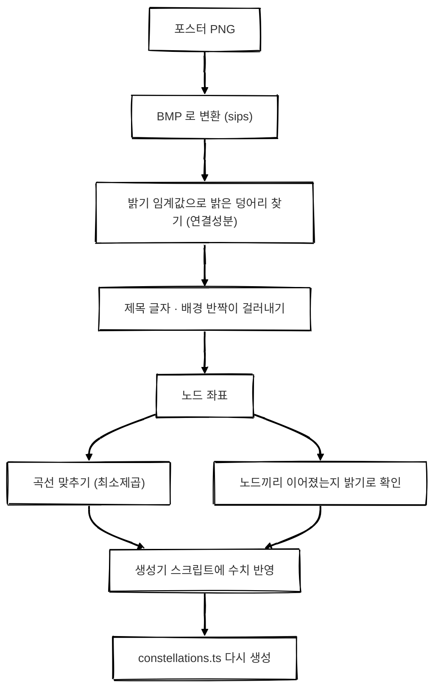
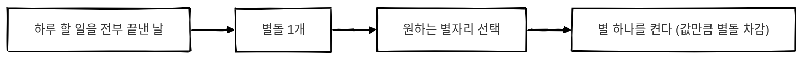
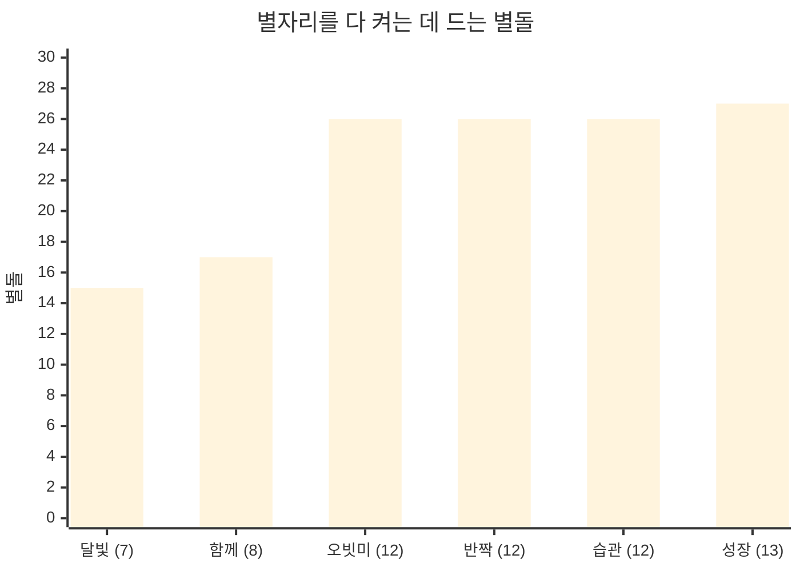

## 개요

OrbitMe에는 **별돌**이 있습니다.
하루 할 일을 전부 끝낸 날 하나가 켜지는 별입니다.

그동안 별돌은 리포트 탭의 히트맵에서 "켜졌다"를 보여 주는 게 전부였습니다.
모은 별돌로 무언가를 할 수 있는 곳이 필요했고, 그게 **별자리 탭**입니다.

{: width="360" }
_완성된 별자리 탭. 오비를 중심으로 별자리 여섯 개가 궤도를 돈다_

 


## 1차 시안은 전부 반려됐다

처음 만든 시안은 한 장도 살아남지 못했습니다.
반려 이유는 세 가지였습니다.

1. **리포트 탭과 똑같다** — 헤더 아래 다크 카드를 쌓는 구성이 리포트와 같았습니다.
2. **별돌이 장식일 뿐이다** — 12~22px 크기로 화면에 뿌려져 있기만 했습니다.
3. **컨셉이 "수집·완성"이라 리포트를 다르게 포장한 것에 가깝다**

여기서 두 탭의 역할을 다시 나눴습니다.

| 탭 | 보여 주는 것 |
| --- | --- |
| 리포트 | 지금 얼마나 잘하고 있나 (추세) |
| 별자리 | 지금까지 무엇을 남겼나 |

리포트에는 이미 별돌 히트맵이 있어서, 별자리 탭에서 날짜 격자를 다시 그리면 같은 화면이 됩니다.
그래서 별자리 탭은 **카드가 아니라 화면 전체를 쓰는 궤도**로 풀었습니다.

 

## 화면 구조

- **궤도** — 오비를 중심으로 별자리가 타원 궤도를 돕니다. 드래그하면 관성으로 돌다가 자동 회전으로 돌아옵니다.
- **목록** — "무엇이 있는지"는 궤도만으로 훑기 어려워서 2열 그리드를 따로 뒀습니다.
- **상세** — 별자리 그림, 문구, 진행 상황, 별돌 먹이기.

 

### 몇 개를 띄울까

처음에는 별자리 25개를 궤도 세 겹에 나눠 올렸습니다.
안쪽 궤도일수록 빠르게 돌게 해서 보기에는 그럴듯했습니다.

그런데 직접 써 보니 **별자리 하나가 40px짜리 점**이라 무슨 모양인지 보이지 않았습니다.
궤도 사이 간격이 40px뿐이라 노드를 키우면 링끼리 겹쳤습니다.

"처음부터 너무 많이 가져가지 말자"로 정리하고 **궤도 하나에 6개**로 줄였습니다.
나머지는 지우지 않고 데이터에 남겨 뒀습니다.
여섯 개는 의미·실루엣·진행도가 서로 겹치지 않게 골랐습니다.

 

## 포스터를 픽셀로 읽기

별자리 도안은 디자인 포스터에서 왔습니다.

_오빗미자리 포스터. 이걸 그대로 앱에 옮겨야 했다_

처음에는 포스터를 보고 좌표를 눈대중으로 옮겼습니다.
그런데 눈으로 옮긴 도안은 매번 "비슷한데 뭔가 다른" 그림이 됐습니다.

그래서 방법을 바꿨습니다.
**포스터를 픽셀로 읽어서 수치를 뽑았습니다.**

 

### 1. 밝은 점 찾기

시스템 Python에 PIL도 numpy도 없어서, `sips` 로 PNG를 24bit BMP로 바꾼 뒤 node로 BMP를 직접 파싱했습니다.

밝기 임계값을 넘는 화소를 이웃끼리 묶으면(연결성분) 별 하나가 덩어리 하나가 됩니다.
포스터 아래쪽 제목 글자도 덩어리로 잡히기 때문에 그림 영역 아래는 잘라 내고, 궤도 밖 배경 반짝이는 면적과 위치로 걸러 냈습니다.

임계값은 포스터마다 달랐습니다.
달빛자리는 150으로 잡으면 나무 전체가 덩어리 하나로 뭉쳐서, 선이 잡히지 않는 230까지 올렸습니다.

 

### 2. 오빗미자리 — 정말 타원 하나인가

오빗미자리 노드 12개에 **일반 원뿔곡선**을 최소제곱으로 맞췄습니다.

$$
ax^2 + bxy + cy^2 + dx + ey + 1 = 0
$$

여기서 중심, 기울기, 장·단반경을 꺼냅니다.
각 점을 식에 넣은 값이 0.97~1.05로 고르게 나와서 "포스터의 궤도는 정말 타원 하나"라는 걸 확인할 수 있었습니다.

결과는 **rx 96 / ry 41 / 기울기 -17.5°, 노드 12개**였습니다.

재미있었던 건 노드 간격이었습니다.
노드 사이 각도가 21~52°로 **일부러 불균등**했습니다.
타원 위에 노드를 고르게 찍으면 큰 별 다섯 개의 자리가 어긋나서 그냥 12각형이 됩니다.
그래서 측정한 각도를 그대로 박는 함수를 따로 만들었습니다.

 

### 3. 선이 이어졌는지는 밝기로 확인

노드만 찾아서는 어느 별끼리 이어졌는지 모릅니다.
두 노드 사이를 직선으로 훑으면서 밝기를 보면 됩니다.

선이 1px이라 한 점만 보면 놓치기 때문에, 선에 수직으로 ±2px 범위의 최댓값을 봤습니다.
실선은 최솟값이 60을 넘었고, 이어지지 않은 짝은 배경 수준(16 근처)으로 떨어졌습니다.

이 방법으로 달빛자리를 쟀더니, 눈으로는 이어진 줄 알았던 두 별이 실제로는 이어져 있지 않았습니다.

점선 구간이 있는 반짝자리에서는 최솟값 대신 **밝은 화소의 비율**로 판정해야 했습니다.
최솟값으로 보면 점선 사이 빈틈에서 배경까지 떨어져 선을 놓칩니다.

 

### 4. 원뿔곡선이 안 맞을 때 — 8자 곡선

함께자리 포스터는 ∞ 모양이었습니다.
일반 원뿔곡선으로는 8자를 맞출 수 없어서 **제로노 레므니스케이트**를 썼습니다.

중심과 기울기로 좌표를 옮긴 $(u, v)$ 에서

$$
v^2 = \alpha u^2 + \beta u^4
$$

는 $\alpha, \beta$ 에 대해 **선형**입니다.
그래서 중심과 기울기만 격자로 훑고, 나머지는 선형 최소제곱으로 바로 풀 수 있습니다.

그런데 이 도안은 결국 쓰지 않았습니다.
곡선을 따라 점을 서른 개 가까이 찍어야 했고, 그러니 별자리가 아니라 **구슬 목걸이**가 됐습니다.
대신 ∞ 를 직선 두 고리로 접은 스케치를 받아서, 정점 8개짜리 도안으로 바꿨습니다.

포스터가 곡선이라고 도안까지 곡선일 필요는 없었습니다.

 

### 5. 숫자만 믿지 말 것

반짝자리의 점선 궤도 두 개를 잴 때 가장 오래 걸렸습니다.
점선과 선 주변 글로우의 밝기가 같아서, 밝기로만 자르면 글로우를 관통하는 엉뚱한 타원이 나왔습니다.

- 답은 **덩어리 크기**였습니다. 점선은 작은 토막이고, 글로우는 큰 덩어리입니다.
- 점수도 "맞은 점 개수" 대신 "덮는 각도 구간 수"로 바꿨습니다. 개수로 세면 몇 군데 뭉친 화소를 지나는 큰 타원이 이깁니다.

그리고 숫자만 보고 "맞았다"고 착각한 게 세 번이었습니다.
**검출한 점을 포스터 위에 다시 칠해 보고 나서야** 확신할 수 있었습니다.

(이렇게 잰 타원 두 개는 결국 "없애고 선을 더 넓게 퍼지게 해 달라"는 피드백으로 빠졌습니다.)

 

### 같은 별자리, 여러 시안

_같은 달빛자리도 시안이 여섯 개였다. 이 중 04-B 를 실측했다_

시안을 고르는 일과 고른 시안을 앱으로 옮기는 일은 따로였습니다.
고르는 건 눈으로, 옮기는 건 측정으로 했습니다.

 

## 장식은 PNG 말고 View

상세 화면의 마법진 테두리와 상단 장식 띠는 처음에 PNG였습니다.
이걸 React Native View로 다시 그렸습니다.

**이유는 용량이 아니라 색이었습니다.**
PNG는 보라색으로 구워져 있어서 별자리마다 색을 바꿀 수 없었습니다.
`tintColor` 로 물들이면 그라데이션이 단색으로 뭉개집니다.

View로 그리면서 몇 가지 요령이 생겼습니다.

- **번짐은 같은 반지름에 두께만 다른 획을 겹쳐서** 만들었습니다. 겹의 불투명도를 가우시안 곡선의 구간 차이로 주면 계단 없이 부드럽게 번집니다.
- **RN에는 타원 보더가 없습니다.** 정원을 그린 뒤 `scaleY` 로 눌러서 타원을 만들었습니다.
- **`react-native-svg` 는 쓰지 않았습니다.** 네이티브 의존성이 추가되면 OTA로 배포할 수 없기 때문입니다. 선은 회전한 View, 별은 이미지 에셋입니다.

마지막 선택에는 대가도 있었습니다.
회전한 View에는 점선이 없어서, 포스터의 점선 궤도는 그대로 옮길 수 없었습니다.

 



## 별돌 경제

마지막으로 정한 건 "별돌로 별자리를 어떻게 켜느냐"였습니다.

- **별돌은 하루에 최대 1개**입니다. 궤도별로 세면 하루 8개까지 올라갈 수 있어서, 별자리는 하루 전체 기준만 봅니다.
- **어느 별자리에 먹일지는 제한하지 않습니다.** 처음에는 "지금 키우는 별자리 하나만" 안을 냈는데, 얕게 여러 개를 켜는 사람도 하나를 깊게 파는 사람도 있으니 선택을 막지 말자는 쪽으로 정해졌습니다.
- **한 번 켜진 별은 꺼지지 않습니다.** 과거에 할 일을 하나 추가해서 그날이 완벽한 날이 아니게 돼도, 이미 켠 별을 되돌리지 않습니다. 완성 연출이 두 번 터지는 일도 막을 수 있습니다.

 

### 별 하나의 값

별 하나의 값은 **별자리 안에서 올라갑니다.**
별 개수가 아니라 진행률로 정해서, 별이 7개든 13개든 곡선 모양이 같습니다.

| 진행 구간 | 별 하나의 값 |
| --- | --- |
| 앞 1/3 | 1 |
| 가운데 1/3 | 2 |
| 뒤 1/3 | 3 |
| 마지막 한 개 | 5 |

여섯 별자리의 별은 모두 64개이고, 전부 켜는 데 드는 별돌은 이렇습니다.

합계는 **137개**입니다.
매일 완벽한 날을 보내면 약 4.6개월, 주 5일이면 약 6.5개월이 걸립니다.

처음 이야기한 안은 3, 5, 7, 9…처럼 2씩 오르는 값이었습니다.
계산해 보니 **842개, 약 2.4년**이 나왔습니다.
오르는 폭이 문제가 아니라 별이 64개라서 생기는 일이라, 이 숫자를 보고 지금의 곡선으로 정했습니다.

 

## 돌아보며

- **모은 것에는 쓸 곳이 있어야 했습니다.** 별돌이 히트맵에서 켜지기만 할 때는 "오늘도 하나 모았다"에서 끝났습니다. 별자리에 먹여 별을 하나씩 켜게 되면서, 완벽한 하루가 눈에 보이는 무언가로 쌓이기 시작했습니다.
- **값을 정할 땐 감보다 계산이 먼저였습니다.** 2씩 오르는 안은 듣기엔 자연스러웠지만, 끝까지 더해 보니 2.4년이었습니다. 숫자를 먼저 뽑아 보고 나서야 "몇 달이면 하나를 완성하는" 지금의 곡선을 고를 수 있었습니다.
- **고르는 자유는 막지 않았습니다.** 하나를 깊게 키우든 여러 개를 얕게 켜든, 별돌을 어디에 쓸지는 사용하는 사람의 몫으로 남겼습니다.
